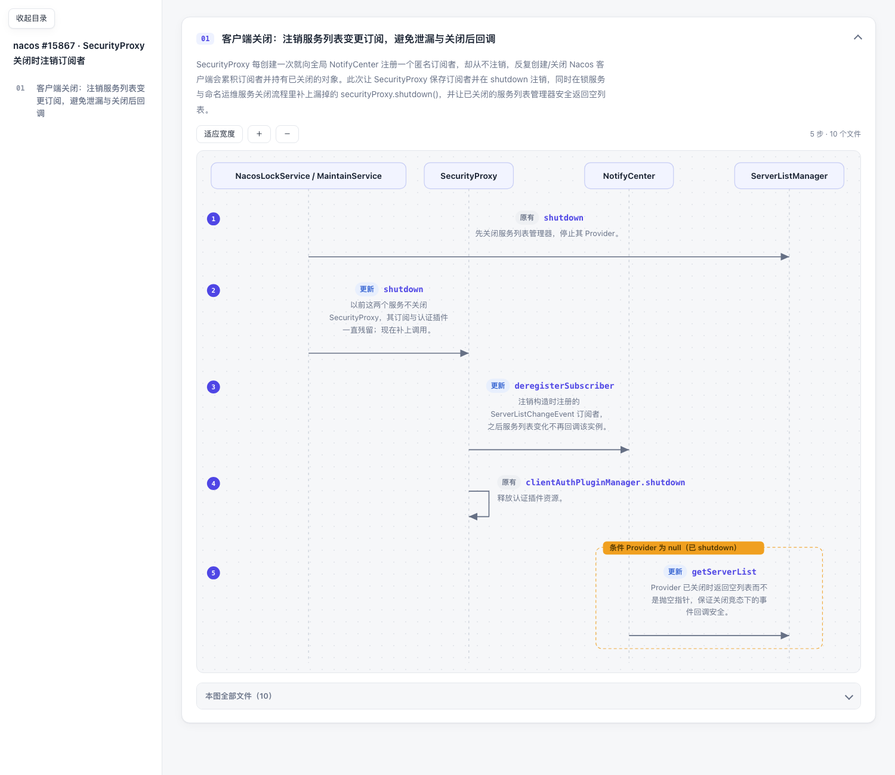

# sequence-code-review

把一次需求的 Git 改动，整理成**可点击代码的业务时序图审查包**。
Code Review 不再从文件列表第一行开始读，而是先看懂「原链路 → 这次改了哪 → 影响谁」，再点进代码。



## 它解决什么

- Diff 按文件排序，看不出业务调用链。
- 新增 / 更新 / 原有逻辑混在一起，容易漏看。
- 无法证明「每个改动文件都被 review 到了」。

## 它做什么

1. Agent 读取 Git 改动与真实调用链，按业务链路划分图，而不是每文件一张图。
2. 每一步标注 `新增 / 更新 / 原有 / 删除`，带一两句中文业务说明；条件分支用虚线框住对应步骤。
3. 每个方法是一个可点击链接，跳到**有业务意义的改动行**（不是 import），IDEA 通过 `idea://open` 打开。
4. 渲染脚本校验：清单里的变更文件必须都映射到图上，否则报错。
5. 输出单个离线 HTML（内联 CSS / JS / SVG，无 CDN），支持深色模式、适应宽度、缩放、拖动。

## 用法

作为 Codex / Claude Code skill 使用：

```bash
git clone https://github.com/<you>/sequence-code-review ~/.codex/skills/sequence-code-review
```

然后对 Agent 说：

> 使用 $sequence-code-review，把本次需求的全部 Git 改动整理成可点击代码的业务时序图审查包，并核验是否有遗漏。

Agent 会读源码、写一个 `review-data.json`，再调用渲染器：

```bash
python3 scripts/render_review.py review-data.json --output review.html
```

只依赖 Python 3 标准库。字段说明见 [references/render-input.md](references/render-input.md)，最小示例见 [assets/review.example.json](assets/review.example.json)。

## 示例

`examples/` 下是用真实开源 PR 生成的三份页面（源码链接是占位路径，不能点开）：

| 页面 | PR |
|---|---|
| `sb-51855.html` | spring-boot #51855 属性迁移器可让应用启动失败 |
| `sb-51844.html` | spring-boot #51844 Caffeine 异步缓存模式 |
| `nacos-15867.html` | nacos #15867 SecurityProxy 关闭时注销订阅者 |

## 边界

- 渲染器只校验输入数据的自洽，**不能证明输入清单就是全部 Git 改动**，需按 SKILL.md 独立核对。
- 图覆盖不等于代码正确，也不代表已审查通过；审查状态默认「未审查」。

## License

MIT
